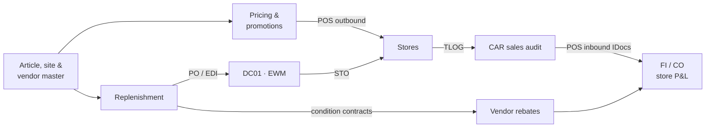

# SAP S/4HANA IS-Retail Implementation – Portfolio Project

**End-to-end implementation plan for SAP IS-Retail (SAP S/4HANA Retail for merchandise management)** for a specialty
apparel and home retailer with one distribution center, 50 stores and an online shop – from business requirements to
hypercare, with a **chart of accounts**, a **verified finance worked example** and a **working Azure ETL pipeline**
that loads the SAP Migration Cockpit staging tables in SAP HANA.

> Portfolio project by **Isaac Detch** – SAP project management consultant (all modules, specialising in FICO).
> The client, figures and data are fictitious; items marked `[VERIFY]` must be confirmed for your S/4HANA release.


## Highlights

| | |
|---|---|
| **Scope** | Merchandise categories, generic/variant articles, sites, assortments, pricing & promotions, replenishment & allocation, EWM, store apps, POS via CAR, vendor rebates (Settlement Management), finance & store P&L |
| **Process design** | Swimlane diagrams for procure-to-DC, store replenishment, POS-to-ledger, pricing and rebates |
| **Chart of accounts** | 114 YCOA-based accounts with account groups, FSV and OBYC/VKOA account determination ([Ch. 5](docs/05-chart-of-accounts.md), [CSV](finance/chart_of_accounts.csv)) |
| **Finance worked example** | One article from PO to balance sheet – journal entries, trial balance, P&L, balance sheet – generated and checked in code ([Ch. 8](docs/08-finance-worked-example.md)) |
| **Data migration** | Azure Data Factory + Databricks + ADLS (bronze/silver/gold) → SAP HANA Migration Cockpit staging tables, with DQ gate and two-stage reconciliation ([Ch. 10](docs/10-data-migration-azure-etl.md), [code](etl/README.md)) |
| **Delivery** | Testing, cutover runbook, go/no-go, pilot + 3 waves, hypercare KPIs, batch schedule, RACI, risks, SAP Activate timeline |

## Contents

| # | Chapter |
|---|---|
| 1 | [Executive summary](docs/01-executive-summary.md) |
| 2 | [Business requirements](docs/02-business-requirements.md) |
| 3 | [Business processes](docs/03-business-processes.md) |
| 4 | [Solution architecture and design](docs/04-solution-design.md) |
| 5 | [Chart of accounts and account determination](docs/05-chart-of-accounts.md) |
| 6 | [Configuration](docs/06-configuration.md) |
| 7 | [Integration](docs/07-integration.md) |
| 8 | [Finance integration and worked example](docs/08-finance-worked-example.md) |
| 9 | [Testing](docs/09-testing.md) |
| 10 | [Data migration – Azure ETL to SAP Migration Cockpit](docs/10-data-migration-azure-etl.md) |
| 11 | [Cutover](docs/11-cutover.md) |
| 12 | [Go-live, hypercare and production](docs/12-go-live-hypercare-production.md) |
| 13 | [Project plan, governance and risks](docs/13-project-plan.md) |
| 14 | [Glossary of abbreviations and terms](docs/14-glossary.md) |
| A | [Transaction code index](docs/appendix-a-transaction-codes.md) |

The full plan is also available as a Word document: [`deliverables/SAP_IS_Retail_Implementation_Plan.docx`](deliverables/SAP_IS_Retail_Implementation_Plan.docx).

## Process at a glance



| Procure to DC | POS to ledger |
|---|---|
|  |  |

## Data migration architecture


```
legacy SQL / files ──SHIR──► ADF pl_10 ──► bronze ──01──► silver ──02 (retail_etl)──► gold
                                                                      │ DQ gate + reconciliation
                                                                      ▼
                         S/4HANA ◄── Migration Cockpit (simulate / migrate) ◄── HANA staging tables (pl_30, JDBC)
                            └──── OData control totals ──► pl_40 reconciliation ──► Power BI
```

## Repository map

| Path | Content |
|---|---|
| [`docs/`](docs) | Implementation plan, chapters 1–14 and appendix (Markdown, renders on GitHub) |
| [`diagrams/`](diagrams) | Process swimlanes, landscape, org structure, cutover, roadmap, ETL architecture (PNG) |
| [`finance/`](finance) | Chart of accounts, account determination, worked example script |
| [`etl/`](etl) | Azure ETL: Bicep, ADF pipelines, Databricks notebooks, `retail_etl` library, SQL, sample data, tests |
| [`tools/`](tools) | Generators for the finance chapters and ETL diagrams |
| [`deliverables/`](deliverables) | Word version of the plan |
| [`.github/workflows/ci.yml`](.github/workflows/ci.yml) | CI: unit tests, finance checks, sample pipeline, doc regeneration check |

## Run it

```bash
pip install -r etl/requirements.txt
python finance/worked_example.py --check          # journal entries, trial balance, statements – all checks PASS
cd etl && python -m pytest                        # 13 tests: transforms, GS1, DQ, reconciliation, staging SQL
PYTHONPATH=src python -m retail_etl.pipeline --source sample_data/legacy --out sample_output
```

## Skills demonstrated

SAP S/4HANA Retail (merchandise management, sites, generic articles, VKP0 pricing, promotions, replenishment, POS/CAR,
Settlement Management) · SAP FI/CO (chart of accounts, OBYC/VKOA, document splitting, store profit centers, close) ·
SAP EWM integration · SAP Migration Cockpit (staging tables) · Azure Data Factory, Databricks, ADLS Gen2, Azure SQL,
Key Vault, Bicep · Python/PySpark · SAP Activate project management, cutover and hypercare.

## Disclaimer

This is an independent portfolio project, not affiliated with or endorsed by SAP SE or Microsoft. SAP, S/4HANA and other
SAP products are trademarks of SAP SE. All company names, people and figures are fictitious.
