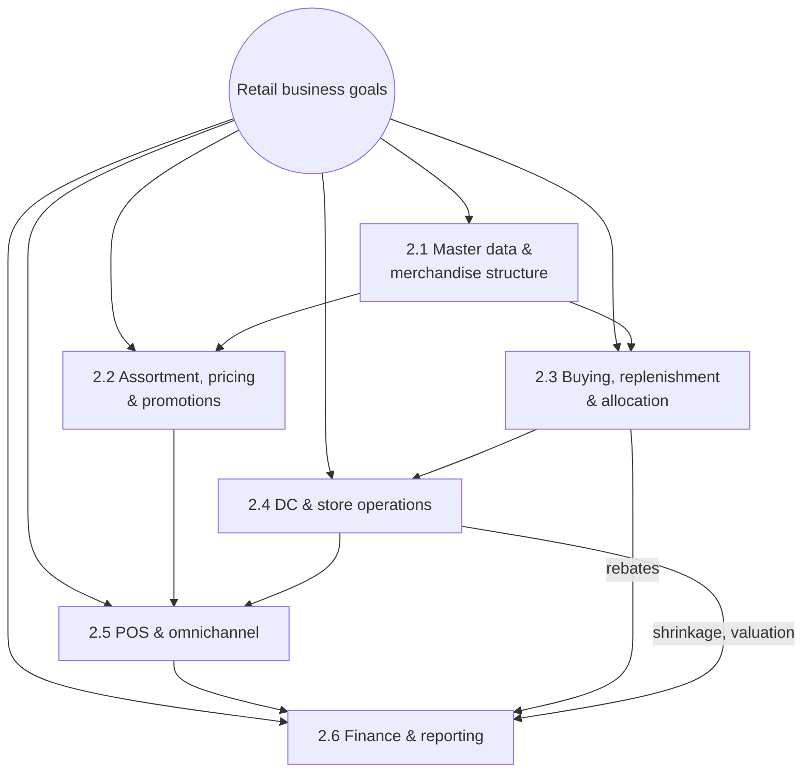

# 2. Business Requirements

[← Contents](../README.md#contents)

*Figure 2-1. Requirement areas and their dependencies – every area ends in finance*

## 2.1 Master data and merchandise structure

| ID | Requirement | Priority | Acceptance criterion |
|---|---|---|---|
| BR-MD-01 | Four-level merchandise category hierarchy (division, department, merchandise category, article). | Must | Every article assigned to one merchandise category (MC); reports roll up by hierarchy. |
| BR-MD-02 | Fashion basics are maintained as generic articles with colour and size variants; each variant has its own EAN/UPC. | Must | Generic article TS-100 creates 3+ variants with EANs. |
| BR-MD-03 | Store, DC and online sites share a template (site profile) and are created in under 30 minutes. | Should | New site created by copy with listing and supply source. |
| BR-MD-04 | Vendors maintained as Business Partners with EDI settings and purchasing conditions. | Must | Vendor BP with purchasing org R100, info records, EDI partner profile. |

## 2.2 Assortment, pricing and promotions

| ID | Requirement | Priority | Acceptance criterion |
|---|---|---|---|
| BR-PR-01 | Articles are listed to stores by assortment (store cluster). | Must | Article sellable only in stores where listed. |
| BR-PR-02 | Retail prices are calculated from cost with margin targets and price-point rounding (e.g. .99). | Must | VKP5 proposes price; price points applied. |
| BR-PR-03 | Promotions with temporary prices by store group and date range are sent to POS automatically. | Must | Promo price active at POS on start date, removed after end date. |
| BR-PR-04 | Price changes reach all POS terminals before store opening. | Must | POS outbound complete by 05:00. |

## 2.3 Buying, replenishment and allocation

| ID | Requirement | Priority | Acceptance criterion |
|---|---|---|---|
| BR-BY-01 | DC replenishment from forecast with vendor lead times; POs sent by EDI. | Must | Replenishment run creates POs; EDI ORDERS transmitted. |
| BR-BY-02 | Store replenishment from DC based on POS consumption (min/max or forecast). | Must | Daily STOs DC01 → stores created automatically. |
| BR-BY-03 | New-season and promotional merchandise allocated to stores by allocation rules. | Should | Allocation table generates STOs / POs by store quantity. |
| BR-BY-04 | Vendor rebates accrued on every invoice and settled per contract. | Must | Condition contract accruals posted; settlement credit to vendor. |

## 2.4 DC and store operations

| ID | Requirement | Priority | Acceptance criterion |
|---|---|---|---|
| BR-OP-01 | DC inbound, putaway, picking and shipping run in EWM with RF devices. | Must | Inbound delivery → GR → putaway; outbound pick → GI. |
| BR-OP-02 | Stores receive DC deliveries on mobile Fiori apps by scanning. | Must | Store GR updates store stock same day. |
| BR-OP-03 | Stores perform cycle counts and annual inventory; differences post to shrinkage. | Must | Count approved; difference to 52300000 by store. |
| BR-OP-04 | Store-to-store transfers are possible. | Should | Transfer posted with in-transit stock. |

## 2.5 Point of sale and omnichannel

| ID | Requirement | Priority | Acceptance criterion |
|---|---|---|---|
| BR-POS-01 | POS sales, returns and tenders from all stores reach S/4HANA daily, audited. | Must | CAR sales audit approves; IDocs processed without errors by 06:00. |
| BR-POS-02 | POS sales reduce store stock and post revenue, tax, cost of sales and tenders. | Must | Postings as in [§8.1](08-finance-worked-example.md). |
| BR-POS-03 | Online orders are fulfilled from the DC or ship-from-store with real-time stock. | Should | Stock availability API returns site stock. |

## 2.6 Finance and reporting

| ID | Requirement | Priority | Acceptance criterion |
|---|---|---|---|
| BR-FI-01 | Inventory valued at moving average cost by site; profit center per store and DC. | Must | Store P&L and inventory by profit center. |
| BR-FI-02 | Cash deposits and card settlements are reconciled automatically by store. | Must | Bank statement auto-match ≥ 95%. |
| BR-FI-03 | Gross margin by store, MC and article available daily. | Must | Margin Analysis and CAR reports. |
| BR-FI-04 | Shrinkage reported by store and MC. | Must | Inventory differences by profit center and MC. |

## 2.7 Non-functional requirements

| ID | Requirement |
|---|---|
| NFR-01 | POS inbound: 50 stores × `[TICKETS_PER_DAY]` tickets/day processed within the 01:00–05:00 window. |
| NFR-02 | Replenishment run for 50 stores × `[ACTIVE_ARTICLES]` articles completes in < 60 minutes. |
| NFR-03 | Store apps available 07:00–23:00 local time; 99.5% availability. |
| NFR-04 | Segregation of duties between price maintenance, vendor master, PO approval and payment. |
| NFR-05 | PCI DSS: no card numbers stored in S/4HANA or CAR; tokenised tenders only. |
