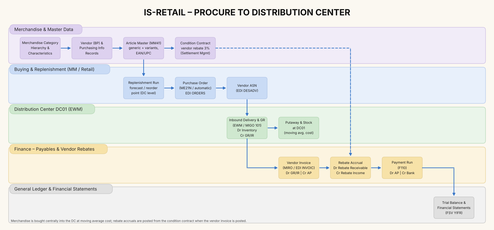
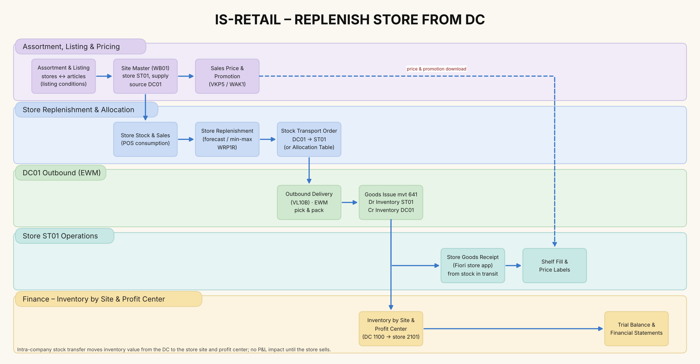
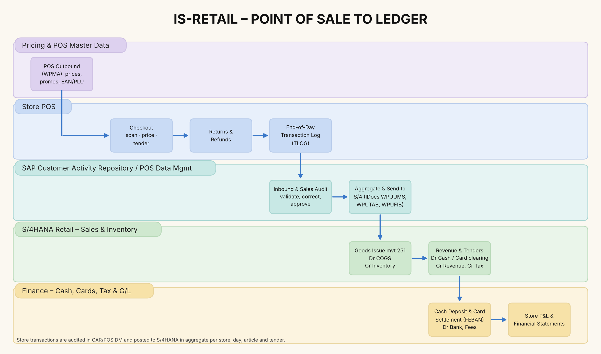
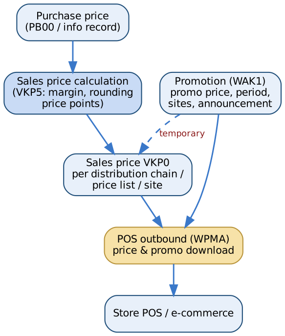
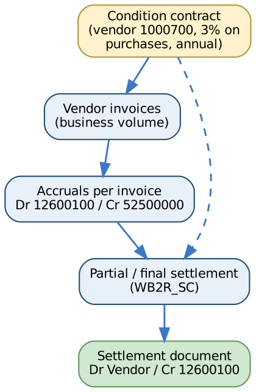

# 3. Business Processes

[← Contents](../README.md#contents)

## 3.1 Process hierarchy

| L1 | L2 | L3 processes |
|---|---|---|
| Merchandise management | Master data | MC hierarchy, article (generic/variant), site, vendor, EAN, characteristics |
|  | Assortment & listing | Assortment creation, store clustering, listing/de-listing |
|  | Pricing & promotions | Sales price calculation, price changes, promotion planning, POS download |
| Buy & move | Procure to DC | Replenishment, PO, EDI, ASN, GR, invoice, rebate accrual, payment |
|  | Replenish store | Store replenishment, allocation, STO, DC pick/ship, store GR |
|  | Inventory | Transfers, counts, adjustments, returns to vendor |
| Sell | Store sales | POS checkout, returns, end-of-day, sales audit, POS inbound |
|  | Online sales | Order capture, availability, fulfilment, returns |
| Finance | Record to report | Cash & card reconciliation, rebates settlement, valuation, store P&L, close, statements |

The three core end-to-end flows are shown below as swimlanes (who does what, in which system).

## 3.2 Procure to distribution center

*Figure 3-1. Procure to DC: master data, replenishment, EDI, goods receipt, invoice, rebate accrual, payment*

## 3.3 Replenish store from DC

*Figure 3-2. Store replenishment and stock transport from DC01 to store ST01*

## 3.4 Point of sale to ledger

*Figure 3-3. POS transactions through CAR sales audit to S/4HANA and finance*

## 3.5 Pricing and promotions

*Figure 3-4. From purchase price to POS price*

## 3.6 Vendor rebates

*Figure 3-5. Condition contract accrual and settlement*
