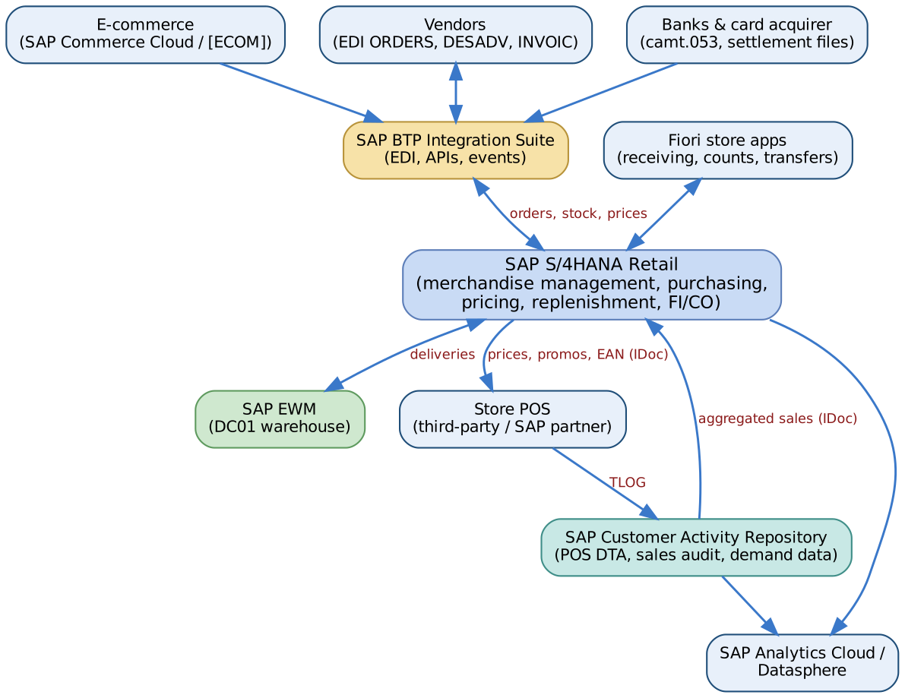
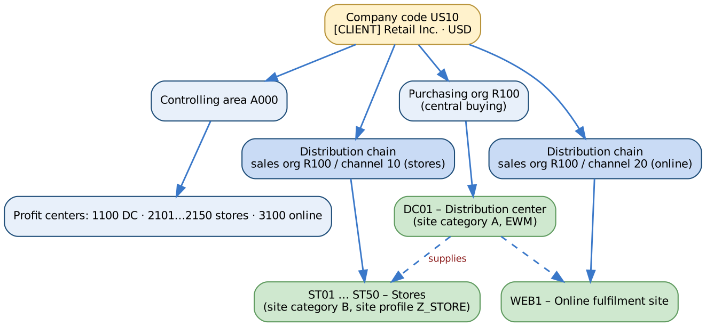
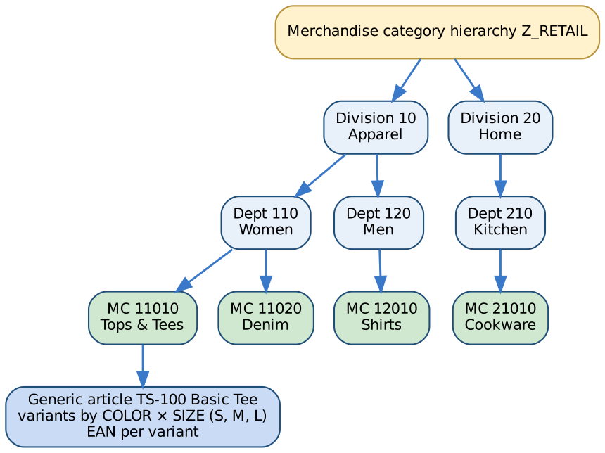

# 4. Solution Architecture and Design

[← Contents](../README.md#contents)

## 4.1 Solution landscape

*Figure 4-1. IS-Retail solution landscape*

| Tier | S/4HANA Retail | CAR / POS DTA | EWM |
|---|---|---|---|
| DEV | `[S4D]` / 100 | `[CARD]` | embedded / `[EWMD]` |
| QA | `[S4Q]` / 200 | `[CARQ]` | `[EWMQ]` |
| PRE-PROD | `[S4R]` / 300 | `[CARR]` | `[EWMR]` |
| PROD | `[S4P]` / 400 | `[CARP]` | `[EWMP]` |

## 4.2 Organisational structure

*Figure 4-2. Retail organisational structure*

| Object | Value | Design note |
|---|---|---|
| Company code | US10 | Legal entity; YCOA; USD |
| Purchasing organisation | R100 | Central buying for all sites |
| Distribution chains | R100/10 stores · R100/20 online | Prices and assortments maintained per distribution chain |
| Sites | DC01 (DC), ST01–ST50 (stores), WEB1 (online) | Each site is a plant + customer; valuation at site level |
| Profit centers | 1100 DC, 2101–2150 stores, 3100 online | Store P&L and balance sheet by document splitting |
| Storage locations | DC01: 0001 (EWM-managed); stores: 0001 sales floor, 0002 back room | Store stock simple, no WM in stores |

## 4.3 Merchandise category hierarchy and articles

*Figure 4-3. Merchandise category hierarchy and generic article*

| Design element | Decision |
|---|---|
| Article categories | 00 single article, 01 generic article (with 02 variants), 11 prepack, 10 sales set |
| Article types | HAWA trading goods for merchandise; NLAG non-stock for store supplies; display and prepack types as required `[VERIFY]` |
| Variant-creating characteristics | COLOR, SIZE assigned to merchandise categories via class type 026 |
| EAN/UPC | Main EAN per variant and unit of measure; additional EANs allowed |
| Article numbering | Generic: external (TS-100); variants: generic + suffix (TS-100-BLK-M) |
| Inventory management | Article-based at site, valuated at moving average price `[DECISION: retail method for stores?]` |

## 4.4 Key design decisions

| ID | Decision | Rationale |
|---|---|---|
| DD-01 | Inventory valuation at moving average cost per site (not retail method) | Accurate COGS by store; simpler with S/4HANA; markdowns do not revalue stock |
| DD-02 | POS integration via CAR / POS DTA with sales audit; aggregated IDocs to S/4 | Volume reduction; audit before posting |
| DD-03 | DC on EWM; stores on Fiori store apps without warehouse management | Right-sized complexity |
| DD-04 | Vendor rebates in condition contracts (Settlement Management) | Replaces legacy subsequent settlement; accruals per invoice |
| DD-05 | One profit center per store | Store P&L and balance sheet |
| DD-06 | Store replenishment from DC only; direct-store-delivery for selected vendors `[DECISION]` | Supply chain control |
