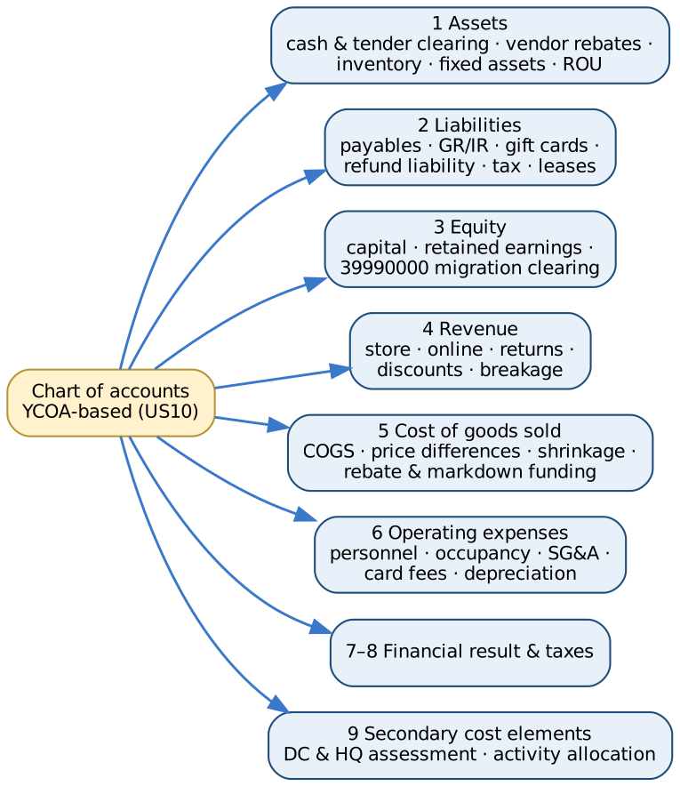

# 5. Chart of Accounts

[← Contents](../README.md#contents)

Company code **US10** uses one operational chart of accounts based on the SAP Best Practices chart **YCOA** (8-digit accounts), extended with retail-specific accounts: POS tender clearing (cash, card, gift card, online payment provider), vendor rebate receivables and income from condition contracts, gift-card and store-credit liabilities, refund liability for expected returns, POS discounts, shrinkage, vendor markdown funding, store occupancy and card fees, and a **data migration clearing account (39990000)** that must be zero after the initial stock and G/L balance loads. The machine-readable source is [`finance/chart_of_accounts.csv`](../finance/chart_of_accounts.csv) (114 accounts).

## 5.1 Design principles

- **YCOA as the base**, so SAP Best Practices content (account determination, financial statement version, reports) works with minimal change; retail accounts are added in free number ranges. Account numbers in this document are the client's design – verify them against the YCOA delivered in your release before build [VERIFY].
- **Inventory at moving average cost per site**; one inventory account (13400000) for all merchandise, split by site and profit center through the material ledger and document splitting.
- **Every POS tender has its own clearing account** that must be zero once the bank deposit or acquirer settlement is matched – the daily control for 50 stores.
- **Vendor rebates and vendor-funded markdowns reduce cost of goods sold** (52500000, 52600000), not revenue.
- **Returns and discounts are revenue deductions** (41100000–41300000) so gross and net sales can be reported by store.
- **Profit center per store and DC** (2101–2150, 1100) with document splitting gives a store P&L and balance sheet.
- **Migration clearing 39990000**: initial stock (movement 561) and G/L balances are both posted against it; it must net to zero (reconciled automatically by the ETL).

## 5.2 Account groups

| Group | Content | Number of accounts |
|---|---|---|
| CASH | Cash, bank and POS tender clearing | 8 |
| RECV | Receivables, vendor rebates, prepaid, tax | 7 |
| INV | Merchandise inventory | 4 |
| FIXA | Fixed assets, right-of-use, intangibles, deferred tax | 17 |
| PAYB | Payables, GR/IR, accruals, gift cards, refund liability, taxes | 16 |
| DEBT | Leases and borrowings | 4 |
| EQTY | Equity | 2 |
| MIGR | Data migration clearing | 1 |
| REVN | Revenue and sales deductions | 9 |
| COGS | Cost of goods sold, shrinkage, rebates | 10 |
| PERS | Personnel | 4 |
| OCCU | Store occupancy | 5 |
| SGA | Selling, general and administrative | 12 |
| DEPR | Depreciation and amortisation | 5 |
| FIN | Financial result | 4 |
| TAX | Income taxes | 2 |
| SECC | Secondary cost elements (CO only) | 4 |

## 5.3 Assets (1xxxxxxx)

| Account | Description | FSV node | Statement line | Account determination | CO |
|---|---|---|---|---|---|
| 11001000 | Bank 1 – Main Account | 1.1.1 | Cash and cash equivalents | House bank (FI12) | Balance sheet |
| 11001010 | Bank 1 – Incoming Payments Clearing | 1.1.1 | Cash and cash equivalents | Bank statement posting rules (OT83) | Balance sheet |
| 11001020 | Bank 1 – Outgoing Payments Clearing | 1.1.1 | Cash and cash equivalents | Payment program (F110) | Balance sheet |
| 11009400 | Store Cash in Transit | 1.1.1 | Cash and cash equivalents | POS inbound tender mapping (cash) | Balance sheet |
| 11009500 | Payment Card Clearing (acquirer) | 1.1.1 | Cash and cash equivalents | POS inbound tender mapping (card) | Balance sheet |
| 11009600 | Online Payment Service Provider Clearing | 1.1.1 | Cash and cash equivalents | Commerce / PSP settlement | Balance sheet |
| 11009700 | Gift Card Redemption Clearing | 1.1.1 | Cash and cash equivalents | POS inbound tender mapping (gift card) | Balance sheet |
| 11009800 | Store Change Funds & Petty Cash | 1.1.1 | Cash and cash equivalents | Cash journal (FBCJ) | Balance sheet |
| 12100000 | Trade Receivables – Domestic (B2B / franchise) | 1.1.2 | Trade receivables | Customer reconciliation account | Balance sheet |
| 12190000 | Allowance for Doubtful Receivables | 1.1.2 | Trade receivables | Manual / valuation | Balance sheet |
| 12600100 | Vendor Rebate Receivable (condition contract accruals) | 1.1.4 | Vendor receivables and rebates | Settlement Management accrual account | Balance sheet |
| 12600200 | Vendor Receivables – Returns to Vendor & Debit Memos | 1.1.4 | Vendor receivables and rebates | MIRO subsequent debit / RTV | Balance sheet |
| 12600300 | Vendor Down Payments | 1.1.4 | Vendor receivables and rebates | Special G/L A (OBYR) | Balance sheet |
| 13400000 | Inventory – Merchandise (trading goods) | 1.1.5 | Inventories | OBYC BSX (valuation class 3100) | Balance sheet |
| 13400100 | Inventory – Stock in Transit (cross-company STO) | 1.1.5 | Inventories | OBYC BSX / UMB | Balance sheet |
| 13400300 | Inventory – Store Supplies & Packaging | 1.1.5 | Inventories | OBYC BSX (valuation class 3050) | Balance sheet |
| 13400900 | Inventory Valuation Adjustment (LCM / NRV) | 1.1.5 | Inventories | Manual / valuation run | Balance sheet |
| 14000000 | Prepaid Expenses (rent deposits, insurance) | 1.1.3 | Other current assets | Manual | Balance sheet |
| 14100000 | Sales & Use Tax Receivable | 1.1.3 | Other current assets | Tax codes (FTXP) | Balance sheet |
| 16100000 | Land | 1.2.1 | Property & equipment | AA account determination (AO90) | Balance sheet |
| 16200000 | Buildings (owned DC) | 1.2.1 | Property & equipment | AO90 | Balance sheet |
| 16300000 | Leasehold Improvements (store fit-out) | 1.2.1 | Property & equipment | AO90 | Balance sheet |
| 16400000 | Store Fixtures & Equipment | 1.2.1 | Property & equipment | AO90 | Balance sheet |
| 16500000 | POS Hardware & IT Equipment | 1.2.1 | Property & equipment | AO90 | Balance sheet |
| 16600000 | DC Material Handling Equipment | 1.2.1 | Property & equipment | AO90 | Balance sheet |
| 16700000 | Assets under Construction (new stores & remodels) | 1.2.1 | Property & equipment | AO90 (AuC settlement) | Balance sheet |
| 16800000 | Right-of-Use Assets – Store & DC Leases | 1.2.2 | Right-of-use assets | Lease accounting (RE-FX / LAE) | Balance sheet |
| 16900000 | Software & Intangible Assets | 1.2.3 | Intangible assets | AO90 | Balance sheet |
| 17200000 | Accumulated Depreciation – Buildings | 1.2.1 | Property & equipment | AO90 | Balance sheet |
| 17300000 | Accumulated Depreciation – Leasehold Improvements | 1.2.1 | Property & equipment | AO90 | Balance sheet |
| 17400000 | Accumulated Depreciation – Store Fixtures | 1.2.1 | Property & equipment | AO90 | Balance sheet |
| 17500000 | Accumulated Depreciation – POS & IT | 1.2.1 | Property & equipment | AO90 | Balance sheet |
| 17600000 | Accumulated Depreciation – DC Equipment | 1.2.1 | Property & equipment | AO90 | Balance sheet |
| 17800000 | Accumulated Amortisation – Right-of-Use Assets | 1.2.2 | Right-of-use assets | Lease accounting | Balance sheet |
| 17900000 | Accumulated Amortisation – Software | 1.2.3 | Intangible assets | AO90 | Balance sheet |
| 18000000 | Deferred Tax Assets | 1.2.4 | Deferred tax assets | Manual | Balance sheet |

## 5.4 Liabilities (2xxxxxxx)

| Account | Description | FSV node | Statement line | Account determination | CO |
|---|---|---|---|---|---|
| 21100000 | Trade Payables – Domestic | 2.1.1 | Trade payables | Vendor reconciliation account | Balance sheet |
| 21100100 | Trade Payables – Foreign (import) | 2.1.1 | Trade payables | Vendor reconciliation account | Balance sheet |
| 21150000 | Payables – Landlords | 2.1.1 | Trade payables | Vendor reconciliation account | Balance sheet |
| 21200000 | GR/IR Clearing – Merchandise | 2.1.2 | GR/IR clearing | OBYC WRX | Balance sheet |
| 21200100 | GR/IR Clearing – Freight & Duties | 2.1.2 | GR/IR clearing | OBYC FR1 / FR3 | Balance sheet |
| 21300000 | Accrued Expenses | 2.1.3 | Accrued and payroll liabilities | Accrual Engine / manual | Balance sheet |
| 21400000 | Payroll Clearing | 2.1.3 | Accrued and payroll liabilities | Payroll posting | Balance sheet |
| 21410000 | Payroll Withholdings & Benefits Payable | 2.1.3 | Accrued and payroll liabilities | Payroll posting | Balance sheet |
| 21500000 | Gift Card Liability (unredeemed) | 2.1.4 | Gift card and customer liabilities | POS inbound (gift card sale) | Balance sheet |
| 21510000 | Customer Deposits & Layaway | 2.1.4 | Gift card and customer liabilities | POS inbound / special G/L | Balance sheet |
| 21520000 | Store Credit & Customer Credit Memos | 2.1.4 | Gift card and customer liabilities | POS inbound | Balance sheet |
| 21530000 | Refund Liability – Expected Returns | 2.1.5 | Refund liabilities | Period-end estimate | Balance sheet |
| 21540000 | Right-to-Recover Returned Goods (contra) | 2.1.5 | Refund liabilities | Period-end estimate | Balance sheet |
| 22000000 | Sales Tax Payable | 2.1.7 | Taxes payable | Tax code MWS / jurisdiction codes | Balance sheet |
| 22100000 | Use Tax Payable | 2.1.7 | Taxes payable | Tax codes | Balance sheet |
| 22200000 | Income Tax Payable | 2.1.7 | Taxes payable | Manual | Balance sheet |
| 23000000 | Lease Liabilities – Current | 2.1.6 | Lease liabilities – current | Lease accounting | Balance sheet |
| 23100000 | Lease Liabilities – Non-current | 2.2.1 | Lease liabilities – non-current | Lease accounting | Balance sheet |
| 23200000 | Revolving Credit Facility & Bank Loans | 2.2.2 | Borrowings | Treasury / manual | Balance sheet |
| 24000000 | Deferred Tax Liabilities | 2.2.3 | Deferred tax liabilities | Manual | Balance sheet |

## 5.5 Equity and migration clearing (3xxxxxxx)

| Account | Description | FSV node | Statement line | Account determination | CO |
|---|---|---|---|---|---|
| 31000000 | Share Capital | 3.1 | Share capital | — | Balance sheet |
| 32000000 | Retained Earnings | 3.2 | Retained earnings | OB53 (balance carry-forward) | Balance sheet |
| 39990000 | Data Migration Clearing (must be zero after go-live) | 3.9 | Migration clearing | OBYC GBB-BSA (mvt 561) / G/L balance load offset | Balance sheet |

## 5.6 Revenue and sales deductions (4xxxxxxx)

| Account | Description | FSV node | Statement line | Account determination | CO |
|---|---|---|---|---|---|
| 41000000 | Revenue – Merchandise Sales (stores) | 4.1.1 | Gross sales | VKOA ERL (POS sales) | Primary – revenue (11) |
| 41000100 | Revenue – Online Sales | 4.1.1 | Gross sales | VKOA ERL | Primary – revenue (11) |
| 41000200 | Revenue – Wholesale & Franchise | 4.1.1 | Gross sales | VKOA ERL | Primary – revenue (11) |
| 41100000 | Sales Returns (contra revenue) | 4.1.2 | Returns and discounts | POS inbound returns (mvt 252) | Primary – sales deduction (12) |
| 41200000 | POS Discounts & Coupons | 4.1.2 | Returns and discounts | POS inbound (discount condition) | Primary – sales deduction (12) |
| 41300000 | Employee Discounts | 4.1.2 | Returns and discounts | POS inbound (discount condition) | Primary – sales deduction (12) |
| 41500000 | Gift Card Breakage Revenue | 4.1.3 | Other revenue | Period-end estimate | Primary – revenue (11) |
| 41600000 | Delivery & Service Fee Revenue (online) | 4.1.3 | Other revenue | VKOA ERL | Primary – revenue (11) |
| 41700000 | Other Operating Income (vendor marketing funds) | 4.1.3 | Other revenue | Settlement Management | Primary – revenue (11) |

## 5.7 Cost of goods sold (5xxxxxxx)

| Account | Description | FSV node | Statement line | Account determination | CO |
|---|---|---|---|---|---|
| 50000000 | COGS – Merchandise (stores) | 5.1.1 | Cost of goods sold | OBYC GBB-VAX (mvt 251) | Primary cost (1) |
| 50000100 | COGS – Merchandise (online) | 5.1.1 | Cost of goods sold | OBYC GBB-VAX | Primary cost (1) |
| 50100000 | Inbound Freight & Duties (not capitalised) | 5.1.2 | Freight and duties | OBYC FRL / manual | Primary cost (1) |
| 50200000 | Price Differences – Merchandise | 5.1.3 | Price differences | OBYC PRD | Primary cost (1) |
| 52300000 | Inventory Differences / Shrinkage | 5.1.4 | Shrinkage rebates and markdowns | OBYC GBB-INV (mvt 701/702) | Primary cost (1) |
| 52400000 | Damaged & Scrapped Merchandise | 5.1.4 | Shrinkage rebates and markdowns | OBYC GBB-VNG (mvt 551) | Primary cost (1) |
| 52500000 | Vendor Rebate Income (COGS reduction) | 5.1.4 | Shrinkage rebates and markdowns | Settlement Management (condition contract) | Primary cost (1) |
| 52600000 | Vendor Promotion & Markdown Funding (COGS reduction) | 5.1.4 | Shrinkage rebates and markdowns | Settlement Management | Primary cost (1) |
| 52700000 | Inventory Write-down to NRV | 5.1.4 | Shrinkage rebates and markdowns | Manual / valuation run | Primary cost (1) |
| 52800000 | Cash Discounts Received | 5.1.4 | Shrinkage rebates and markdowns | OBXU SKE | Primary cost (1) |

## 5.8 Operating expenses (6xxxxxxx)

| Account | Description | FSV node | Statement line | Account determination | CO |
|---|---|---|---|---|---|
| 61000000 | Salaries & Wages – Stores | 6.1 | Personnel expenses | Payroll posting | Primary cost (1) |
| 61000100 | Salaries & Wages – DC | 6.1 | Personnel expenses | Payroll posting | Primary cost (1) |
| 61000200 | Salaries & Wages – Head Office | 6.1 | Personnel expenses | Payroll posting | Primary cost (1) |
| 61100000 | Payroll Taxes & Benefits | 6.1 | Personnel expenses | Payroll posting | Primary cost (1) |
| 62000000 | Rent & Occupancy – Stores (variable & short-term) | 6.2 | Occupancy expenses | FB60 / RE-FX | Primary cost (1) |
| 62100000 | Common Area Maintenance | 6.2 | Occupancy expenses | FB60 | Primary cost (1) |
| 62200000 | Utilities | 6.2 | Occupancy expenses | FB60 | Primary cost (1) |
| 62300000 | Store Maintenance & Repairs | 6.2 | Occupancy expenses | FB60 / PM order | Primary cost (1) |
| 62400000 | Security & Loss Prevention | 6.2 | Occupancy expenses | FB60 | Primary cost (1) |
| 63000000 | Advertising & Marketing | 6.3 | Selling general and administrative | FB60 | Primary cost (1) |
| 63100000 | Store Supplies & Shopping Bags | 6.3 | Selling general and administrative | OBYC GBB-VBR (cost center) | Primary cost (1) |
| 63200000 | Outbound Freight & E-commerce Fulfilment | 6.3 | Selling general and administrative | Shipment cost settlement | Primary cost (1) |
| 63300000 | IT & Software Subscriptions | 6.3 | Selling general and administrative | FB60 | Primary cost (1) |
| 63400000 | Communication | 6.3 | Selling general and administrative | FB60 | Primary cost (1) |
| 63500000 | Insurance | 6.3 | Selling general and administrative | FB60 | Primary cost (1) |
| 63600000 | Bank & Payment Card Fees | 6.3 | Selling general and administrative | Bank statement posting rules (acquirer fee) | Primary cost (1) |
| 63700000 | Cash Handling (armoured car) | 6.3 | Selling general and administrative | FB60 | Primary cost (1) |
| 63800000 | Professional Fees | 6.3 | Selling general and administrative | FB60 | Primary cost (1) |
| 63900000 | Travel | 6.3 | Selling general and administrative | FB60 | Primary cost (1) |
| 64000000 | Depreciation – Leasehold Improvements & Fixtures | 6.4 | Depreciation and amortisation | AO90 / AFAB | Primary cost (1) |
| 64100000 | Depreciation – POS & IT | 6.4 | Depreciation and amortisation | AO90 / AFAB | Primary cost (1) |
| 64200000 | Depreciation – DC Equipment & Buildings | 6.4 | Depreciation and amortisation | AO90 / AFAB | Primary cost (1) |
| 64300000 | Lease Cost / ROU Amortisation | 6.4 | Depreciation and amortisation | Lease accounting | Primary cost (1) |
| 64400000 | Amortisation – Software | 6.4 | Depreciation and amortisation | AO90 / AFAB | Primary cost (1) |
| 65000000 | Store Pre-opening Costs | 6.3 | Selling general and administrative | Project settlement | Primary cost (1) |
| 65100000 | Gain / Loss on Disposal of Assets | 6.3 | Selling general and administrative | AO90 | Primary cost (1) |

## 5.9 Financial result (7xxxxxxx)

| Account | Description | FSV node | Statement line | Account determination | CO |
|---|---|---|---|---|---|
| 70000000 | Interest Income | 7.1 | Financial result | Manual / treasury | P&L (not CO-relevant) |
| 70100000 | Interest Expense | 7.1 | Financial result | Manual / treasury | P&L (not CO-relevant) |
| 70200000 | Interest on Lease Liabilities | 7.1 | Financial result | Lease accounting | P&L (not CO-relevant) |
| 70300000 | Exchange Rate Differences (import purchases) | 7.1 | Financial result | OBA1 KDF / KDB | P&L (not CO-relevant) |
| 79000000 | Income Tax Expense – Current | 8.1 | Income taxes | Manual | P&L (not CO-relevant) |
| 79100000 | Income Tax Expense – Deferred | 8.1 | Income taxes | Manual | P&L (not CO-relevant) |

## 5.11 Secondary cost elements (CO) (9xxxxxxx)

| Account | Description | FSV node | Statement line | Account determination | CO |
|---|---|---|---|---|---|
| 94000000 | Assessment – DC Costs to Stores | 9.0 | — (secondary; nets to zero) | Assessment cycle (KSU1) | Secondary – assessment (42) |
| 94100000 | Assessment – Head Office Costs to Stores | 9.0 | — (secondary; nets to zero) | Assessment cycle (KSU1) | Secondary – assessment (42) |
| 94200000 | Activity Allocation – DC Handling (cases picked) | 9.0 | — (secondary; nets to zero) | Activity type CASE (KP26) | Secondary – activity allocation (43) |
| 96000000 | Settlement – Store Opening & Remodel Projects | 9.0 | — (secondary; nets to zero) | Settlement profile (WBS → AuC) | Secondary – internal settlement (21) |

## 5.12 Automatic account determination

| Area | Key | Business event | Debit | Credit |
|---|---|---|---|---|
| MM (OBYC) | BSX | Inventory posting – all merchandise movements (valuation class 3100) | 13400000 | 13400000 |
| MM (OBYC) | WRX | GR/IR clearing – vendor goods receipt vs invoice | 21200000 | 21200000 |
| MM (OBYC) | PRD | Price differences when stock is insufficient to absorb invoice variance | 50200000 | 50200000 |
| MM (OBYC) | GBB-VAX | POS sale / delivery goods issue (mvt 251 / 601) – cost of goods sold | 50000000 |  |
| MM (OBYC) | GBB-INV | Physical inventory differences (mvt 701 / 702) | 52300000 | 52300000 |
| MM (OBYC) | GBB-VNG | Scrapping damaged merchandise (mvt 551) | 52400000 |  |
| MM (OBYC) | GBB-VBR | Store supplies consumed to cost center | 63100000 |  |
| MM (OBYC) | GBB-BSA | Initial stock entry at migration (mvt 561) | 13400000 (via BSX) | 39990000 |
| MM (OBYC) | FR1 / FR3 | Freight and duty clearing (planned delivery costs) | 21200100 | 21200100 |
| SD (VKOA) | ERL | POS and online revenue by account assignment group |  | 41000000 / 41000100 |
| SD (VKOA) | ERS | Sales deductions – discounts and coupons | 41200000 |  |
| Tax | MWS | Output sales tax by jurisdiction |  | 22000000 |
| POS inbound | Tender – cash | Store cash takings | 11009400 |  |
| POS inbound | Tender – card | Card takings (acquirer) | 11009500 |  |
| POS inbound | Tender – gift card redemption | Gift card used as tender | 21500000 |  |
| POS inbound | Return (mvt 252) | Customer return – revenue and stock reversed | 41100000 / 13400000 | 11009400 / 50000000 |
| Bank (OT83) | Store deposit | Cash deposited at bank | 11001000 | 11009400 |
| Bank (OT83) | Acquirer settlement | Card settlement net of fees | 11001000 / 63600000 | 11009500 |
| Settlement Mgmt | Condition contract accrual | Vendor rebate accrual per invoice | 12600100 | 52500000 |
| Settlement Mgmt | Condition contract settlement | Rebate settled to vendor (credit memo) | 21100000 | 12600100 |
| Asset Accounting (AO90) | Acquisition / depreciation | Store fit-out and POS hardware | 16300000-16500000 / 64000000-64100000 | 21100000 / 17300000-17500000 |

## 5.13 Financial statement version (FSV US10)

| Node | Line |
|---|---|
| 1.1.1 | Cash and cash equivalents |
| 1.1.2 | Trade receivables |
| 1.1.3 | Other current assets |
| 1.1.4 | Vendor receivables and rebates |
| 1.1.5 | Inventories |
| 1.2.1 | Property & equipment |
| 1.2.2 | Right-of-use assets |
| 1.2.3 | Intangible assets |
| 1.2.4 | Deferred tax assets |
| 2.1.1 | Trade payables |
| 2.1.2 | GR/IR clearing |
| 2.1.3 | Accrued and payroll liabilities |
| 2.1.4 | Gift card and customer liabilities |
| 2.1.5 | Refund liabilities |
| 2.1.6 | Lease liabilities – current |
| 2.1.7 | Taxes payable |
| 2.2.1 | Lease liabilities – non-current |
| 2.2.2 | Borrowings |
| 2.2.3 | Deferred tax liabilities |
| 3.1 | Share capital |
| 3.2 | Retained earnings |
| 3.9 | Migration clearing |
| 4.1.1 | Gross sales |
| 4.1.2 | Returns and discounts |
| 4.1.3 | Other revenue |
| 5.1.1 | Cost of goods sold |
| 5.1.2 | Freight and duties |
| 5.1.3 | Price differences |
| 5.1.4 | Shrinkage rebates and markdowns |
| 6.1 | Personnel expenses |
| 6.2 | Occupancy expenses |
| 6.3 | Selling general and administrative |
| 6.4 | Depreciation and amortisation |
| 7.1 | Financial result |
| 8.1 | Income taxes |

Configuration of the chart (OB13, OB62, OBD4, FS00, OB53, OBYC, VKOA, AO90, OB58, document splitting) is in [Chapter 6](06-configuration.md#69-chart-of-accounts-and-finance-integration).
