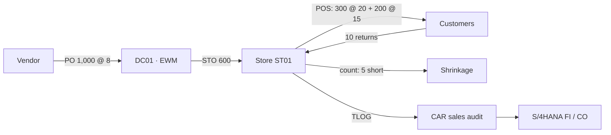

# 8. Finance Integration and Worked Example

[← Contents](../README.md#contents)

This chapter follows one article from purchase to the financial statements. Every amount below is produced and
checked by [`finance/worked_example.py`](../finance/worked_example.py) (run in CI): each entry balances, the trial balance
balances, the balance sheet balances, all clearing accounts are zero and inventory equals units on hand × moving average cost.
All accounts come from the chart of accounts in [Chapter 5](05-chart-of-accounts.md).

## 8.1 Retail events and their postings

| Event | Movement / document | Debit | Credit |
|---|---|---|---|
| Vendor goods receipt at DC | 101 / WE | 13400000 Inventory (DC01) | 21200000 GR/IR |
| Vendor invoice | MIRO / RE | 21200000 GR/IR | 21100000 Vendor |
| Rebate accrual | Condition contract | 12600100 Rebate receivable | 52500000 Rebate income |
| Stock transfer DC → store | 641 / 101 | 13400000 (ST01, PC 2101) | 13400000 (DC01, PC 1100) |
| POS sale – stock | 251 | 50000000 COGS | 13400000 Inventory (store) |
| POS sale – revenue & tenders | POS inbound | 11009400 cash, 11009500 card | 41000000 revenue, 22000000 tax |
| POS return | 252 | 41100000 returns, 22000000 tax, 13400000 | 11009400 cash, 50000000 COGS |
| Cash deposit / card settlement | FEBAN | 11001000 bank, 63600000 card fees | 11009400 / 11009500 |
| Inventory difference | 701 / 702 | 52300000 Shrinkage | 13400000 Inventory |
| Initial stock at migration | 561 | 13400000 Inventory | 39990000 Migration clearing |

## 8.2 Scenario

Company code US10 starts with USD 100,000 of capital. It buys 1,000 Basic Tees (generic article TS-100, variants S/M/L) at
USD 8 into DC01, moves 600 to store ST01, sells 300 at the regular price of USD 20 and 200 at the promotion
price of USD 15 (promotion PR-FALL), accepts 10 returns, counts 5 units of shrinkage, accrues a 3% vendor rebate
and pays store payroll and rent. Sales tax is 8%; two thirds of tenders are card (2.5% acquirer fee).

## 8.3 Journal entries

| Step | Transaction | Doc | G/L | Account | Debit | Credit | Assignment |
|---|---|---|---|---|---|---|---|
| 0 | Migration Cockpit – G/L balances | SA | 11001000 | Bank 1 – Main Account | 100,000.00 |  |  |
|  |  |  | 31000000 | Share Capital |  | 100,000.00 |  |
| R1 | WRP1R / ME21N | — | — | Replenishment proposal and PO: 1000 x TS-100 (variants S/M/L) @ 8 for DC01 – no posting |  |  |  |
| R2 | MIGO 101 / EWM inbound | WE | 13400000 | Inventory – Merchandise (trading goods) | 8,000.00 |  | BSX · site DC01 · PC 1100 |
|  |  |  | 21200000 | GR/IR Clearing – Merchandise |  | 8,000.00 | WRX |
| R3 | MIRO | RE | 21200000 | GR/IR Clearing – Merchandise | 8,000.00 |  | WRX |
|  |  |  | 21100000 | Trade Payables – Domestic |  | 8,000.00 | Vendor 1000700 |
| R4 | Condition contract accrual | SA | 12600100 | Vendor Rebate Receivable (condition contract accruals) | 240.00 |  | Condition contract CC-0001 |
|  |  |  | 52500000 | Vendor Rebate Income (COGS reduction) |  | 240.00 | COGS reduction |
| R5 | F110 | ZP | 21100000 | Trade Payables – Domestic | 8,000.00 |  |  |
|  |  |  | 11001000 | Bank 1 – Main Account |  | 8,000.00 |  |
| D1 | STO · VL10B · VL02N (mvt 641) | WL | 13400000 | Inventory – Merchandise (trading goods) | 4,800.00 |  | Site ST01 · PC 2101 |
|  |  |  | 13400000 | Inventory – Merchandise (trading goods) |  | 4,800.00 | Site DC01 · PC 1100 |
| D2 | Store GR (Fiori, mvt 101) | — | — | Goods receipt in store from stock in transit – value already moved at goods issue |  |  |  |
| S1 | POS inbound WPUUMS (mvt 251) | WA | 50000000 | COGS – Merchandise (stores) | 4,000.00 |  | GBB-VAX · ST01 |
|  |  |  | 13400000 | Inventory – Merchandise (trading goods) |  | 4,000.00 | BSX · ST01 |
| S2 | POS inbound WPUUMS / WPUTAB | RV | 11009400 | Store Cash in Transit | 3,240.00 |  | Tender: cash |
|  |  |  | 11009500 | Payment Card Clearing (acquirer) | 6,480.00 |  | Tender: card |
|  |  |  | 41000000 | Revenue – Merchandise Sales (stores) |  | 9,000.00 | VKOA ERL · ST01 |
|  |  |  | 22000000 | Sales Tax Payable |  | 720.00 | MWS |
| S3 | POS inbound return (mvt 252) | RV | 41100000 | Sales Returns (contra revenue) | 200.00 |  | Sales returns |
|  |  |  | 22000000 | Sales Tax Payable | 16.00 |  |  |
|  |  |  | 11009400 | Store Cash in Transit |  | 216.00 | Cash refund |
|  |  |  | 13400000 | Inventory – Merchandise (trading goods) | 80.00 |  | Mvt 252 · ST01 |
|  |  |  | 50000000 | COGS – Merchandise (stores) |  | 80.00 |  |
| S4 | FEBAN – store deposit | ZB | 11001000 | Bank 1 – Main Account | 3,024.00 |  |  |
|  |  |  | 11009400 | Store Cash in Transit |  | 3,024.00 |  |
| S5 | FEBAN – acquirer settlement | ZB | 11001000 | Bank 1 – Main Account | 6,318.00 |  |  |
|  |  |  | 63600000 | Bank & Payment Card Fees | 162.00 |  | CC store ST01 |
|  |  |  | 11009500 | Payment Card Clearing (acquirer) |  | 6,480.00 |  |
| S6 | Store physical inventory (mvt 702) | WI | 52300000 | Inventory Differences / Shrinkage | 40.00 |  | GBB-INV · ST01 |
|  |  |  | 13400000 | Inventory – Merchandise (trading goods) |  | 40.00 | ST01 |
| O1 | Payroll posting | Y2 | 61000000 | Salaries & Wages – Stores | 1,500.00 |  | CC store ST01 |
|  |  |  | 21400000 | Payroll Clearing |  | 1,500.00 |  |
| O2 | Bank transfer | ZP | 21400000 | Payroll Clearing | 1,500.00 |  |  |
|  |  |  | 11001000 | Bank 1 – Main Account |  | 1,500.00 |  |
| O3 | FB60 | KR | 62000000 | Rent & Occupancy – Stores (variable & short-term) | 1,200.00 |  | CC store ST01 |
|  |  |  | 21150000 | Payables – Landlords |  | 1,200.00 | Landlord 1000800 |
| C1 | FB50 | SA | 79000000 | Income Tax Expense – Current | 554.00 |  | 25% x 2,218 |
|  |  |  | 22200000 | Income Tax Payable |  | 554.00 |  |
| | | | | **Total** | **111,698.00** | **111,698.00** | |

## 8.4 Inventory roll-forward

| Movement | DC01 units | ST01 units | Value (USD) |
|---|---|---|---|
| Vendor GR | 1000 |  | 8,000.00 |
| STO DC01 → ST01 | −600 | +600 | 0.00 (site transfer) |
| POS sales |  | −500 | (4,000.00) |
| POS returns |  | +10 | 80.00 |
| Shrinkage |  | −5 | (40.00) |
| **Closing** | **400** | **105** | **4,040.00** |

## 8.5 Trial balance

| G/L account | Description | FSV | Debit | Credit |
|---|---|---|---|---|
| 11001000 | Bank 1 – Main Account | 1.1.1 | 99,842.00 |  |
| 12600100 | Vendor Rebate Receivable (condition contract accruals) | 1.1.4 | 240.00 |  |
| 13400000 | Inventory – Merchandise (trading goods) | 1.1.5 | 4,040.00 |  |
| 21150000 | Payables – Landlords | 2.1.1 |  | 1,200.00 |
| 22000000 | Sales Tax Payable | 2.1.7 |  | 704.00 |
| 22200000 | Income Tax Payable | 2.1.7 |  | 554.00 |
| 31000000 | Share Capital | 3.1 |  | 100,000.00 |
| 41000000 | Revenue – Merchandise Sales (stores) | 4.1.1 |  | 9,000.00 |
| 41100000 | Sales Returns (contra revenue) | 4.1.2 | 200.00 |  |
| 50000000 | COGS – Merchandise (stores) | 5.1.1 | 3,920.00 |  |
| 52300000 | Inventory Differences / Shrinkage | 5.1.4 | 40.00 |  |
| 52500000 | Vendor Rebate Income (COGS reduction) | 5.1.4 |  | 240.00 |
| 61000000 | Salaries & Wages – Stores | 6.1 | 1,500.00 |  |
| 62000000 | Rent & Occupancy – Stores (variable & short-term) | 6.2 | 1,200.00 |  |
| 63600000 | Bank & Payment Card Fees | 6.3 | 162.00 |  |
| 79000000 | Income Tax Expense – Current | 8.1 | 554.00 |  |
|  | **Total** |  | **111,698.00** | **111,698.00** |

## 8.6 Income statement (store ST01 = company in this example)

| Line | USD |
|---|---|
| Gross sales (41000000) | 9,000.00 |
| Returns (41100000) | (200.00) |
| **Net sales** | **8,800.00** |
| Cost of goods sold at moving average cost (50000000) | (3,920.00) |
| Vendor rebate income (52500000) | 240.00 |
| Shrinkage (52300000) | (40.00) |
| **Gross margin** | **5,080.00** |
| Store payroll (61000000) | (1,500.00) |
| Store rent (62000000) | (1,200.00) |
| Card fees (63600000) | (162.00) |
| **Profit before tax** | **2,218.00** |
| Income tax 25% (79000000) | (554.00) |
| **Net income** | **1,664.00** |

## 8.7 Balance sheet

| Line | USD |
|---|---|
| Cash and bank (11001000) | 99,842.00 |
| Vendor rebate receivable (12600100) | 240.00 |
| Inventory – DC01 400 + ST01 105 units × 8 (13400000) | 4,040.00 |
| **Total assets** | **104,122.00** |
| Payables – landlord (21150000) | 1,200.00 |
| Sales tax payable (22000000) | 704.00 |
| Income tax payable (22200000) | 554.00 |
| **Total liabilities** | **2,458.00** |
| Share capital (31000000) | 100,000.00 |
| Net income for the period | 1,664.00 |
| **Total equity** | **101,664.00** |
| **Total liabilities and equity** | **104,122.00** |

> **Checks (automated):** assets 104,122.00 = liabilities 2,458.00 + equity 101,664.00. GR/IR (21200000), store cash in transit
> (11009400) and card clearing (11009500) are zero because every receipt, deposit and settlement has been matched – the target daily state for every store.

## 8.8 Store KPIs from the example

| KPI | Value |
|---|---|
| Net sales ST01 | 8,800.00 |
| Gross margin % | 57.7% |
| Promotion share of units | 40% |
| Shrinkage % of net sales | 0.45% |
| Return rate (units) | 2.0% |
| Sell-through ST01 | 82% |

## 8.9 Daily finance controls in production

| Control | Account / report | Target |
|---|---|---|
| POS cash takings deposited | 11009400 Store cash in transit by store | 0 after bank statement |
| Card settlements received | 11009500 Payment card clearing | 0 after acquirer file |
| Goods received = invoiced | 21200000 GR/IR | Ageing < 30 days |
| Rebates accrued | 12600100 vs condition contract | Accrual = contract rate × invoiced value |
| Store stock accuracy | 52300000 Shrinkage by store and MC | < 1.5% of sales |
| Migration clearing | 39990000 | 0 from go-live onwards |
