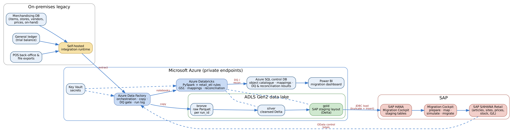
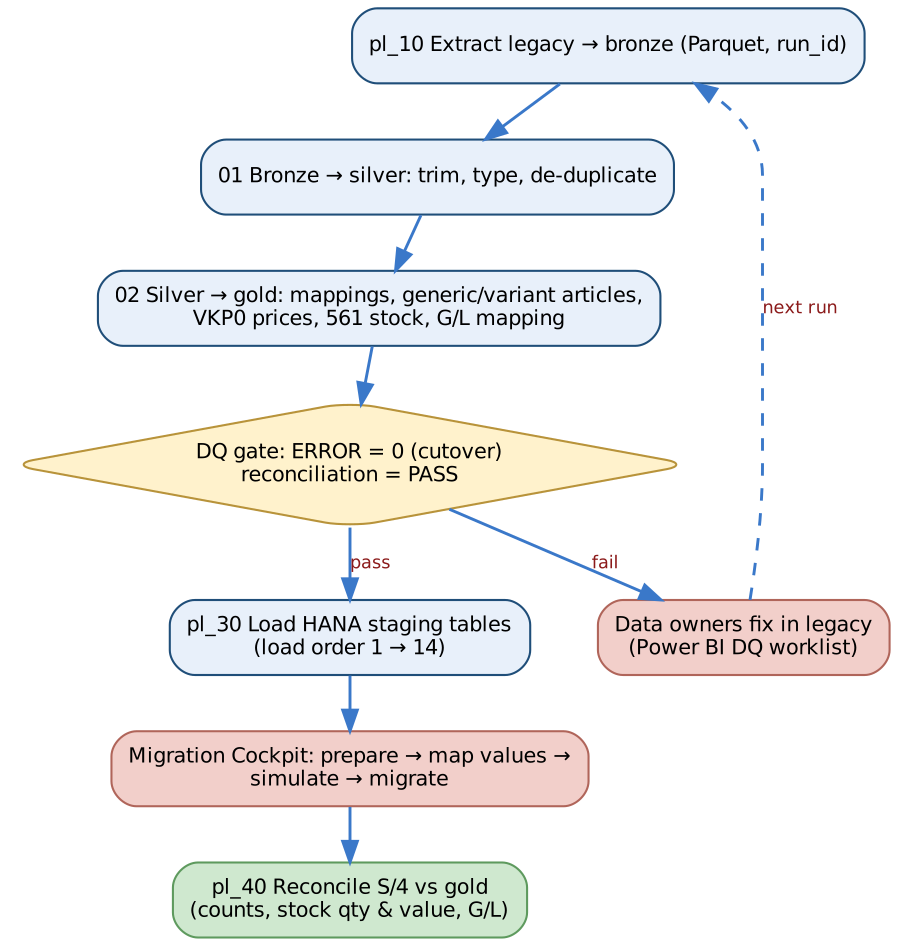
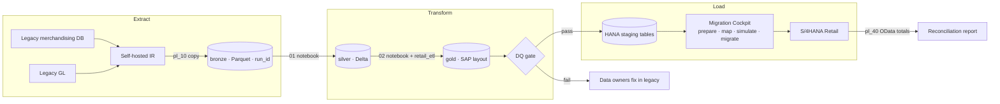

# 10. Data Migration – Azure ETL to the SAP Migration Cockpit

[← Contents](../README.md#contents)

Legacy merchandising, POS back-office and finance data is **extracted, cleansed and transformed in Microsoft Azure** and
loaded into the **staging tables of the SAP S/4HANA Migration Cockpit in the SAP HANA database**. The Migration Cockpit
then performs the final, validated transfer into S/4HANA through its standard migration objects and APIs. Azure does
the heavy lifting (profiling, mapping, de-duplication, GS1 checks, reconciliation and repeatable mock runs); SAP keeps
control of the business-logic checks and the posting into the application.

A working reference implementation is in [`etl/`](../etl/README.md): Bicep infrastructure, Data Factory pipelines,
Databricks notebooks, a tested Python transformation library, control-database SQL and a sample run with deliberate
data defects.

*Figure 10-1. Azure ETL architecture – legacy → ADF → ADLS bronze/silver/gold (Databricks) → HANA staging → Migration Cockpit → S/4HANA*

## 10.1 Migration approach

| Decision | Choice | Rationale |
|---|---|---|
| Migration approach | New implementation (greenfield) of S/4HANA Retail; legacy is non-SAP | Clean master data and new merchandise category design |
| Transfer method | Migration Cockpit – **Migrate Data Using Staging Tables** | Volume (articles × variants × sites), repeatable loads, DB-level population from an external ETL |
| ETL platform | Azure Data Factory + Azure Databricks + ADLS Gen2 | Client standard cloud; scales for POS history; Git-versioned, testable code |
| Staging connection | Databricks → SAP HANA JDBC (ngdbc) into the staging schema; alternative: ADF copy via ODBC on the self-hosted IR | Staging tables are plain HANA tables; truncate + insert per object per run |
| Data quality | Rules in code (`retail_etl`) with results in Azure SQL and Power BI | DQ worklist for data owners; objective load gate |
| Reconciliation | Source → gold (Azure) and gold → S/4HANA (OData / CDS) | Two-stage proof: nothing lost in transformation, nothing lost in the load |
| What is not migrated | Closed POs, POS transactions (24 months of sales history loaded to CAR/forecasting separately), history of prices | Keeps cutover window to one night |

## 10.2 End-to-end flow

*Figure 10-2. Pipeline sequence with the data-quality gate*

## 10.3 Azure components

| Component | Purpose | Implementation |
|---|---|---|
| Self-hosted integration runtime | Secure access from Azure to on-premises legacy SQL Server and file shares | `shir-onprem`, registered in ADF |
| Azure Data Factory | Orchestration, extract copy, DQ gate, logging, retries | [`etl/adf/pipeline`](../etl/adf/pipeline) – `pl_00_master_migration` runs pl_10 → pl_20 → pl_30 → pl_40 |
| ADLS Gen2 | Medallion lake: **bronze** raw Parquet per `run_id`, **silver** cleansed Delta, **gold** SAP staging layout, **archive** | HNS enabled, ZRS, public access disabled, private endpoints |
| Azure Databricks | PySpark transformations calling the shared `retail_etl` library; HANA JDBC load | [`etl/databricks`](../etl/databricks) notebooks 01–04 |
| Azure SQL (control DB) | Object catalogue and load order, value mappings, run log, DQ results, reconciliation, readiness view | [`etl/sql/azure_sql`](../etl/sql/azure_sql) |
| Key Vault | Legacy, HANA and S/4 credentials; accessed by managed identity | Secret scope `kv-migration` |
| Log Analytics | ADF / Databricks diagnostics and alerts | Diagnostic settings in Bicep |
| Power BI | Migration dashboard: DQ worklist per data owner, load readiness, reconciliation | Reads `etl.v_load_readiness`, `etl.dq_result`, `etl.recon_result` |
| Infrastructure as code | Repeatable environments (dev / test / prod migration) | [`etl/infra/main.bicep`](../etl/infra/main.bicep) |

## 10.4 Medallion layers

| Layer | Content | Rules |
|---|---|---|
| Bronze | Exact copy of the legacy extract, partitioned by `run_id` (MOCK1, MOCK2, MOCK3, CUTOVER) | Immutable; kept for audit |
| Silver | Typed, trimmed, de-duplicated legacy data in legacy structure | Technical cleansing only – no business mapping |
| Gold | One table per migration object, SAP technical field names, values mapped to S/4HANA | Business mapping, GS1 checks, generic/variant build, 561 stock, G/L mapping; rejected rows go to DQ, never silently dropped |

## 10.5 Transformation rules (silver → gold)

| Object | Key transformation | Code |
|---|---|---|
| Site | Store / DC / web → site category **VLFKZ A (store) / B (DC)**, site profile Z_STORE / Z_DC / Z_WEB; profit center DC01 → 1100, ST*nn* → 21*nn*, WEB1 → 3100; ZIP zero-padded | `transform.sites` |
| Supplier | Vendor → Business Partner (grouping Y101), reconciliation account 21100000, purchasing org R100; **duplicate tax ID = ERROR**, missing bank = WARNING + payment block | `transform.suppliers` |
| Article | Legacy style → **generic article (ATTYP 01)**, each colour/size SKU → **variant (ATTYP 02)**; department/class → merchandise category (e.g. 10-100 → 11010); UPC checked with the **GS1 check digit**; EAN category UC (12-digit) / HE | `transform.articles`, `quality.gtin_check_digit` |
| Sales price | Retail price → **VKP0** condition per sales org R100 / channel 10, valid from go-live; WARNING for price points not ending .99/.00 and price below cost | `transform.sales_prices` |
| Inventory balance | Post-count on-hand → **movement type 561** per site / storage location 0001, value = quantity × moving average cost; ERROR for unknown site/article and negative stock | `transform.inventory_balances` |
| G/L balance | Legacy account → YCOA account via `mapping_rules.yaml`; **legacy inventory account re-pointed to 39990000** because the 561 stock load already posts inventory; trial balance must balance | `transform.gl_balances` |

All mappings are configuration, not code: [`etl/config/mapping_rules.yaml`](../etl/config/mapping_rules.yaml) and the
`map.value_mapping` table in the control database (approved by the data owner for each object).

## 10.6 Data quality gate

| Severity | Meaning | Effect |
|---|---|---|
| ERROR | The record would fail or corrupt S/4HANA (invalid / duplicate GTIN, unmapped merchandise category, unknown site, negative stock, duplicate supplier) | Excluded from gold, reported to the data owner. **Cutover run requires zero open ERRORs** |
| WARNING | Loadable but needs business attention (price point, missing bank details) | Loaded; on the worklist |
| Reconciliation FAIL | Totals do not agree (rows, stock value, migration clearing) | ADF `Fail` activity – nothing is loaded to HANA |

`pl_20_transform` evaluates the gate. In mock runs the parameter `allow_dq_errors = true` lets valid records through so
the Migration Cockpit can be tested while defects are fixed; for the cutover run it is `false`.

**Sample run** (fictitious legacy extract with deliberate defects – [`etl/sample_output`](../etl/sample_output)):

| Object | Severity | Findings | Examples |
|---|---|---|---|
| article | ERROR | 4 | UPC fails GS1 check digit; duplicate UPC; department 90-900 not mapped |
| inventory_balance | ERROR | 25 | Stock for rejected articles; negative on-hand |
| sales_price | WARNING | 2 | Price point not ending .99 / .00 |
| supplier | ERROR | 2 | Two vendors share one tax ID – merge before load |
| supplier | WARNING | 1 | No bank details – payment block until four-eyes verification |

| Reconciliation check | Expected | Actual | Status |
|---|---|---|---|
| Site: source rows = gold + rejected | 7 | 7 | PASS |
| Supplier: source rows = gold + rejected | 5 | 5 | PASS |
| Article: source variants = gold variants + rejected | 13 | 13 | PASS |
| Stock value (561) = legacy G/L inventory | 15,520.00 | 15,520.00 | PASS |
| Migration clearing 39990000 nets to zero | 0.00 | 0.00 | PASS |

## 10.7 Loading the Migration Cockpit staging tables

1. **Create the migration project** in the Fiori app *Migrate Your Data – Migration Cockpit*, method *Migrate Data Using Staging Tables*, with a database connection to the staging schema (same HANA database or a remote one) `[VERIFY]` for your release.
2. **Select migration objects** (Site, Supplier, Article, Condition record for pricing in sales, Material inventory balance, G/L account balance …). The cockpit generates one staging table per structure (names such as `/1LT/DS_MGRxxx…`).
3. **Record the generated table names** in [`etl/config/staging_tables.yaml`](../etl/config/staging_tables.yaml) and compare each staging structure with the gold layout (download the staging template).
4. **Load staging**: `pl_30_load_hana_staging` reads the object catalogue in load order and runs notebook `03_load_hana_staging` per object – truncate, then batched insert over JDBC with the technical user `MIG_LOADER` (password from Key Vault).
5. **Prepare and map values** in the cockpit (e.g. legacy UoM, country, merchandise category if not mapped in Azure) – most mapping is already done in gold, so the cockpit mapping tasks are confirmations.
6. **Simulate** each object (no posting; full application checks) and fix errors at source → re-run the pipeline.
7. **Migrate** in load order; the cockpit records status per staging record (processed, error).
8. **Reconcile**: `pl_40_reconcile` runs notebook `04_reconcile_target`, reading S/4HANA OData / CDS views (articles, sites, stock by site, G/L balances) and comparing them with the gold control totals.

> **Important:** Staging table names, structures and the available migration objects differ by S/4HANA release and are generated per project. Never hard-code them – keep them in configuration and re-check after each upgrade or project copy.

## 10.8 Migration object sequence

| Load | Object | Migration Cockpit object | Azure gold | Dependency | Validation |
|---|---|---|---|---|---|
| 1 | Sites (DC, stores, web) | Site `[VERIFY]` | `site` | Org structure configured | Site count; profit center |
| 2 | Merchandise categories & hierarchy | Configuration / upload `[VERIFY]` | (config) | — | Hierarchy compare |
| 3 | Suppliers (BP, bank) | Supplier | `supplier` | — | Count; bank four-eyes check |
| 4 | Articles (generic, variants, EANs) | Article `[VERIFY]` | `article` | 2, 3 | Count by MC; EAN uniqueness |
| 5 | Purchasing info records | Purchasing info record | (phase 2 of ETL) | 3, 4 | Cost sample |
| 6 | Listings / assortments | Upload `[VERIFY]` | (phase 2 of ETL) | 1, 4 | Article–site count |
| 7 | Sales prices (VKP0) | Condition record for pricing in sales | `sales_price` | 4, 6 | Price compare vs legacy POS |
| 8–11 | Promotions, replenishment parameters, condition contracts, POS initialisation | Manual / upload / WPMI | — | 7 | Business sign-off |
| 12 | Stock balances DC & stores (from count) | Material inventory balance (561) | `inventory_balance` | 1, 4 | Qty & value = count × cost |
| 13 | Open POs and STOs | Purchase order (only open) | (phase 2 of ETL) | 3, 4 | Open qty / value |
| 14 | G/L balances, open AP/AR | G/L account balance; open items | `gl_balance` | 12 | TB = legacy; 39990000 = 0 |

## 10.9 Financial reconciliation of the migration

The initial stock load (561) posts **Dr 13400000 Inventory / Cr 39990000 Migration clearing** (OBYC GBB-BSA). The G/L
balance load posts all other legacy balances and **Dr 39990000 for the legacy inventory balance** (the ETL re-points the
legacy inventory account to 39990000). After both loads, 39990000 must be zero; any difference is a stock-vs-ledger
difference that finance must explain before go/no-go.

| Step | Dr | Cr | Amount (sample) |
|---|---|---|---|
| Stock load 561 | 13400000 Inventory | 39990000 Migration clearing | 15,520.00 |
| G/L balance – inventory line | 39990000 Migration clearing | (offset in balance load) | 15,520.00 |
| **39990000 balance** | | | **0.00** |

## 10.10 Mock loads

| Mock | Environment | Data | Run parameters | Exit criteria |
|---|---|---|---|---|
| Mock 1 | QA | Pilot stores + DC, 20% of articles | `run_id=MOCK1`, `allow_dq_errors=true` | ≥ 90% load success; DQ worklist issued |
| Mock 2 | QA | All stores, all articles | `MOCK2`, `allow_dq_errors=true` | ≥ 98%; price and stock reconcile |
| Mock 3 / dress rehearsal | PRE-PROD | Full volume, cutover timings | `MOCK3`, `allow_dq_errors=false` | ≥ 99.5%; zero ERRORs; within cutover window |
| Cutover | PROD | Full volume after physical count | `CUTOVER`, `allow_dq_errors=false` | Reconciliation PASS; sign-off by data owners and finance |

> **Important:** Article and EAN quality is the biggest migration risk in retail. The GS1, duplicate-EAN and unmapped-MC checks run in every mock; no article may go live without an EAN, merchandise category, listing and price.

## 10.11 Roles and security

| Topic | Design |
|---|---|
| Data ownership | Each object has a business data owner in `etl.migration_object` who signs off the DQ worklist and reconciliation |
| Credentials | Only in Key Vault; ADF and Databricks use managed identities |
| Network | Private endpoints for ADLS, SQL, Key Vault, Databricks; SHIR outbound only |
| Personal data | Supplier bank details encrypted at rest; lake access by Entra ID groups; bronze retention ends 90 days after go-live |
| HANA user | `MIG_LOADER` with write access only to the staging schema |
| Audit | Every run logged in `etl.run_log` with run_id, row counts and user |
