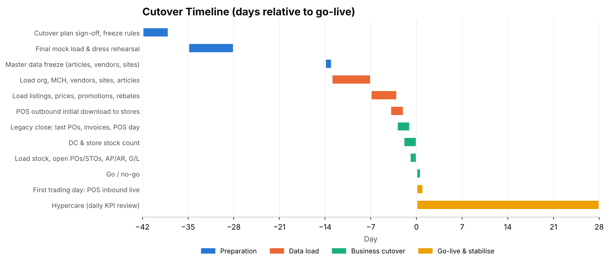

# 11. Cutover

[← Contents](../README.md#contents)

*Figure 11-1. Cutover timeline*

## 11.1 Cutover strategy

- **Pilot then waves**: DC01 and 5 pilot stores go live first; remaining 45 stores in waves of 10–15 stores per week. Until a store migrates, its POS continues on legacy; DC01 supplies both.
- **Go-live on a Sunday night** after store close, before the lowest-volume trading day.
- **Stock baseline by physical count** in DC and stores, loaded at count cost.
- **Freeze periods**: master data freeze T-14; price and promotion freeze T-7 (only emergency changes); no new POs in legacy from T-3.

## 11.2 Cutover runbook (excerpt)

| # | Time | Task | Owner | Dependency |
|---|---|---|---|---|
| 1 | T-14 | Freeze article, vendor and site changes in legacy | Master data lead | — |
| 2 | T-13 … T-8 | Load sites, MCs, vendors, articles, info records, listings (objects 1–6) | Data migration lead | 1 |
| 3 | T-7 | Load prices, promotions, replenishment parameters, rebates (7–10) | Pricing / buying | 2 |
| 4 | T-4 | POS outbound initialisation; verify price files on pilot terminals | POS lead | 3 |
| 5 | T-3 | Last legacy POs; legacy invoice cut-off | Buying / AP | — |
| 6 | T-2 (after close) | Physical count DC01 and pilot stores | Store & DC managers | 5 |
| 7 | T-1 | Load stock, open POs/STOs, AP/AR, G/L balances; reconcile | Data migration / finance | 6 |
| 8 | T-1 20:00 | Go / no-go meeting | Steering committee | 7 |
| 9 | T-0 06:00 | Open stores on S/4 prices; POS sends TLOG to CAR | Store operations | 8 |
| 10 | T+1 01:00 | First POS inbound run; first replenishment run | Hypercare team | 9 |

## 11.3 Go / no-go criteria

| Criterion | Threshold |
|---|---|
| Stock load reconciled to count | 100% of sites; value difference < 0.1% |
| Article, EAN, price completeness | 100% of listed articles have EAN, price and listing |
| POS outbound verified on pilot terminals | Sample of 200 articles per store scanned correctly |
| Open sev-1 / sev-2 defects | 0 / ≤ 3 with workaround |
| Users trained & authorised | ≥ 95% of store and DC users |
| Hypercare staffed | War room, service desk and store champions confirmed |
| Rollback plan | Legacy POS and merchandising available for 2 weeks |
