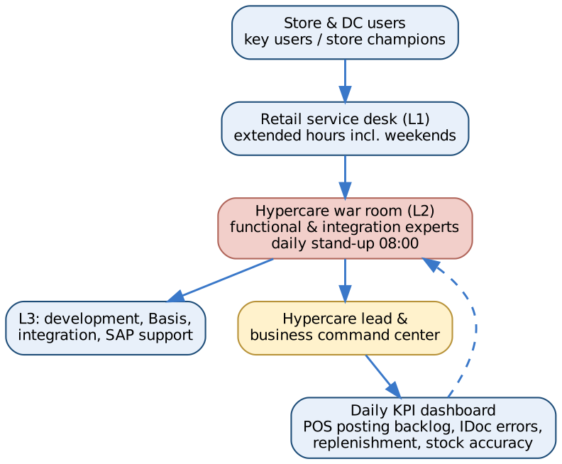

# 12. Go-Live, Hypercare and Production

[← Contents](../README.md#contents)

## 12.1 First-week checklist

| Day | Checkpoint | Owner |
|---|---|---|
| Day 1 morning | All pilot stores open; POS prices correct; first sales scanned | Store ops / POS lead |
| Day 1 evening | End-of-day TLOG received in CAR for every store | CAR lead |
| Day 2 06:00 | POS inbound processed; store sales posted; no WPER errors outstanding | Hypercare |
| Day 2 | Replenishment run created STOs; DC wave picked and shipped | Supply chain |
| Day 3 | Store GR of first DC deliveries; in-transit stock clears | Stores |
| Day 3–5 | Bank statements matched for cash & card | Finance |
| Day 5 | First weekly store P&L reviewed | Finance / merchandising |
| Day 7 | Wave 2 readiness review | PMO |

## 12.2 Rollout waves

| Wave | Sites | Timing | Entry criteria |
|---|---|---|---|
| Pilot | DC01 + ST01–ST05 | Week 52 | Go/no-go passed |
| Wave 1 | ST06–ST20 | Week 55 | Pilot stable 2 weeks; KPIs green |
| Wave 2 | ST21–ST35 | Week 58 | Wave 1 stable |
| Wave 3 | ST36–ST50 + WEB1 | Week 61 | Wave 2 stable |

## 12.3 Hypercare organisation

*Figure 12-2. Hypercare organisation*

## 12.4 Hypercare model

| Element | Design |
|---|---|
| Duration | 4 weeks after pilot; 2 weeks after each wave (overlapping) |
| War room | Daily 08:00 stand-up; functional, integration, Basis, CAR, EWM and business leads |
| Store support | Store champions in every store; floor-walkers in pilot stores for first 3 days |
| Service desk | Extended hours 06:00–23:00 incl. weekends; retail ticket categories |
| Escalation | Sev-1 to hypercare lead within 15 minutes; SAP incident for product defects |

## 12.5 Hypercare KPIs

| KPI | Target | Source |
|---|---|---|
| POS inbound IDocs in error at 06:00 | 0 | WPER / CAR |
| Stores with missing TLOG | 0 | CAR monitor |
| Price discrepancies reported by stores | < 5 per day (pilot) | Service desk |
| Replenishment run completed by 23:30 | 100% | Job monitor |
| Store GR within 24 h of DC GI | ≥ 95% | In-transit stock report |
| Bank statement auto-match | ≥ 95% | FEBAN |
| Open sev-1 / sev-2 tickets | 0 / < 5 | ITSM |

## 12.6 Exit criteria

- Two consecutive weeks with all hypercare KPIs green.
- No open sev-1 tickets; sev-2 tickets have agreed fix dates.
- First month-end close completed by WD+4 with store P&Ls.
- Knowledge transfer to the support organisation signed off; runbooks and job schedule handed over.

## 12.7 Daily batch schedule

| Time | Job | Purpose | Owner |
|---|---|---|---|
| 01:00 | CAR outbound to S/4 (aggregated sales) | Post store sales | CAR / Basis |
| 01:30–05:00 | POS inbound processing (WPUUMS, WPUTAB, WPUFIB) | Stock, revenue, tenders | Basis |
| 02:00 | POS outbound change pointers (WPMA job) | Prices & promotions to POS | Basis |
| 05:00 | POS error check (WPER) & alert | Ensure completeness | Hypercare / AMS |
| 06:00 | Bank statement import | Cash & card reconciliation | Finance |
| 22:00 | Store replenishment run (WRP1R) | Create STOs | Supply chain |
| 22:30 | STO → delivery creation (VL10B job) | DC waves | Supply chain |
| Weekly | DC replenishment / forecast | Vendor POs | Buying |
| Monthly | Rebate partial settlement (WB2R_SC); close tasks | Rebates & close | Finance |

## 12.8 Support model

| Tier | Scope | Provider |
|---|---|---|
| L0 | Store champions, knowledge base | Business |
| L1 | Service desk, password/role, triage | `[SERVICE_DESK]` |
| L2 | Retail functional (merchandising, POS, replenishment, finance) | Retail CoE / `[AMS_PROVIDER]` |
| L3 | Development, integration, Basis | `[AMS_PROVIDER]` |
| L4 | SAP product support | SAP |

## 12.9 Continuous improvement

- Monthly review of POS errors, price discrepancies and replenishment accuracy by store.
- Quarterly release for enhancements and SAP Feature Pack adoption.
- Phase 2 backlog: fashion seasons, unified demand forecast, markdown optimisation, loyalty.
