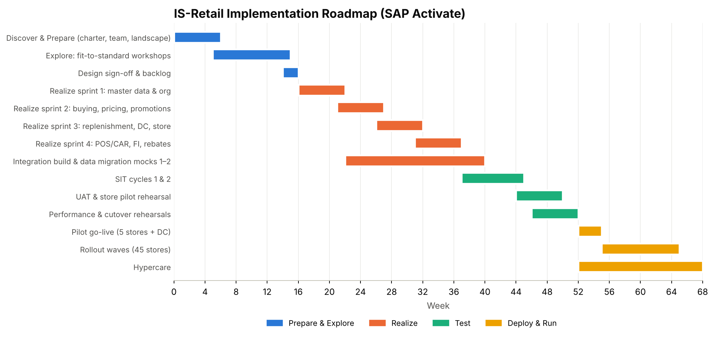
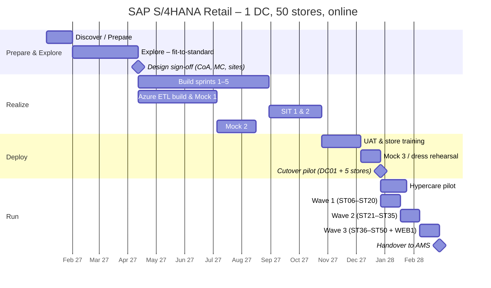

# 13. Project Plan, Governance and Risks

[← Contents](../README.md#contents)

*Figure 13-1. Implementation roadmap*

## 13.0 Timeline (SAP Activate)

Illustrative start date 4 January 2027 – shift to the actual project start.

## 13.1 Workstreams

| Workstream | Scope | Lead |
|---|---|---|
| Merchandise master data | MC, articles, sites, vendors, listing | `[MD_LEAD]` |
| Pricing & promotions | Price calculation, promotions, POS outbound | `[PRICING_LEAD]` |
| Buying & replenishment | Purchasing, replenishment, allocation, rebates | `[BUY_LEAD]` |
| DC & store operations | EWM, store apps, inventory | `[OPS_LEAD]` |
| POS & CAR | POS interface, sales audit, devices | `[POS_LEAD]` |
| Finance | FI/CO, valuation, cash & card, close | `[FIN_LEAD]` |
| Data migration | Objects, mocks, reconciliation | `[DM_LEAD]` |
| Integration & technology | BTP, EDI, Basis, security | `[TECH_LEAD]` |
| Change & training | Store training, communications, store champions | `[OCM_LEAD]` |
| Test & cutover | Test management, cutover runbook | `[TEST_LEAD]` |

## 13.2 RACI

| Activity | Sponsor | Merch. GPO | Ops GPO | Finance GPO | Workstream lead | SI partner | IT | Store ops |
|---|---|---|---|---|---|---|---|---|
| Requirements sign-off | A | R | R | R | C | C | I | C |
| Solution design | I | A | C | C | R | R | C | C |
| Configuration build | I | C | C | C | A | R | C | I |
| Data cleansing | I | A | R | R | C | C | I | R |
| Mock loads & reconciliation | I | C | C | A | R | R | R | I |
| UAT sign-off | I | A | A | A | R | C | I | R |
| Cutover execution | I | C | C | C | R | R | A | R |
| Go / no-go | A | R | R | R | C | C | C | C |
| Hypercare | I | C | C | C | R | R | A | R |

## 13.3 Key risks

| Risk | Impact | Mitigation |
|---|---|---|
| Poor article/EAN data quality | Wrong prices, unsellable items | Early cleansing, EAN checks in every mock, data owners per MC |
| POS integration volume / timing | Late store P&L, stock errors | Performance test at full volume; aggregation in CAR |
| Store adoption | Manual workarounds | Store champions, floor-walkers, simple Fiori apps |
| Promotion complexity | Price errors at POS | Limit promotion types in phase 1; regression tests |
| Peak season timing | Business disruption | No go-live in Nov–Dec; freeze periods |
| Legacy coexistence during waves | Supply and reporting gaps | DC supplies both; interim reporting bridge |
| Legacy data quality blocks the Azure ETL load gate at cutover | Go-live delay | DQ worklists from Mock 1 onward; data owners sign off per object; zero-ERROR target by Mock 3 |
| Migration Cockpit staging structures change after an upgrade or project copy | Failed staging load | Staging table names in configuration; template comparison step in every mock |
